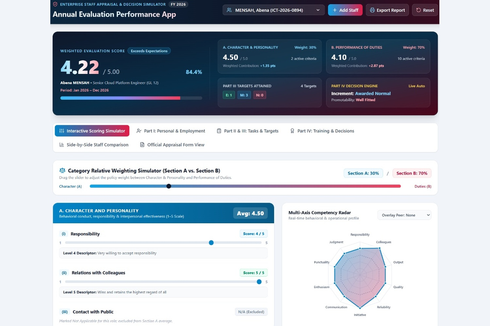
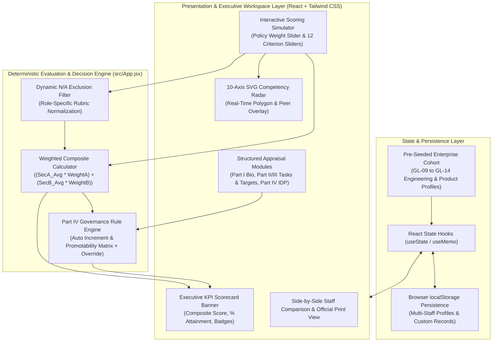

# Annual Evaluation Performance App
### Enterprise Staff Appraisal & Policy Weighting Decision Simulator

[](https://annual-evaluation-performance-app.vercel.app/)
[](https://github.com/sampeter-akan/annual-evaluation-performance-app)
[](https://react.dev/)
[](https://tailwindcss.com/)
[](https://vitejs.dev/)

---

## Executive Overview

The **Annual Evaluation Performance App** is an enterprise-grade, interactive staff appraisal platform and decision-support simulator engineered to modernize legacy annual performance reviews. Designed for **Chief Human Resources Officers (CHROs), People Operations Directors, Compensation Committees, and Fortune 500 Talent Acquisition Teams**, the platform replaces static, spreadsheet-driven appraisals with a transparent, auditable, and real-time policy modeling engine.

Organizations frequently struggle with appraisal inflation, opaque promotion criteria, and disconnected compensation decisions. This application solves those bottlenecks by unifying **behavioral conduct scoring (Section A)**, **operational duty execution (Section B)**, **quarterly target attainment (Part III)**, and **automated increment/promotability governance (Part IV)** into a single executive workspace.

> **Live Application:** [https://annual-evaluation-performance-app.vercel.app/](https://annual-evaluation-performance-app.vercel.app/)

---

## Application Preview



*(Note: Place `enterprise-annual-performance-app-cover-1500x1000.jpg` inside your `public/` directory so it renders automatically in GitHub and serves cleanly from the production build.)*

---

## Enterprise Business Value & Problems Solved

| Enterprise Pain Point | Architectural Solution in This Platform |
| :--- | :--- |
| **Subjective & Inconsistent Grading** | Enforces standardized 1–5 behavioral and operational rubric descriptors across 12 core criteria, ensuring uniform calibration across business units. |
| **Rigid Compensation & Policy Models** | Provides a **Category Relative Weighting Simulator** (`Section A` vs. `Section B`), enabling HR leaders to model how shifting organizational priorities (e.g., *30% Conduct / 70% Output* vs. *50% / 50%*) impacts promotion eligibility before finalizing annual cycles. |
| **Disconnected Goal Tracking** | Directly ties **Part III Target Attainment** (*Exceeded / Met / Not Met*) into the **Part IV Decision Engine**, preventing high conduct scores from masking missed operational KPIs. |
| **Calibration & Peer Benchmarking Friction** | Features a **10-Axis SVG Competency Radar** with real-time peer overlay and a **Side-by-Side Staff Comparison** matrix for talent review committees. |
| **Audit & Compliance Documentation** | Generates a clean, print-ready **Official Appraisal Form View** with multi-tier executive sign-offs (Appraisee, Reporting Officer, Countersigning Officer, and HR/Establishment Review) and one-click PDF export. |

---

## System Architecture

The application follows a decoupled, client-side reactive architecture optimized for zero-latency policy simulation, deterministic scoring calculations, and browser-persistent state management.



---

## Core Functional Modules

### 1. Interactive Scoring & Policy Weighting Simulator
* **Dynamic Category Weighting:** Adjust relative weights between **Section A (Character & Personality)** and **Section B (Performance of Duties)** in real time to stress-test compensation budgets and promotion cutoffs.
* **Granular Rubric Calibration:** Score individual competencies on a 1–5 scale with live level descriptors, plus automatic **N/A Exclusion** logic for role-irrelevant criteria (e.g., *Contact with Public* for internal infrastructure engineers) so averages remain mathematically unbiased.

### 2. Multi-Axis SVG Competency Radar & Peer Benchmarking
* Custom-engineered vector radar plotting 10 core organizational dimensions (*Responsibility, Colleagues, Output, Quality, Reliability, Initiative, Communication, Enthusiasm, Punctuality, Judgment*).
* Supports instant **Peer Overlay Comparison**, allowing HR executives and department heads to visually contrast candidate profiles against high-performing benchmarks.

### 3. Automated Part IV Decision Engine
* Evaluates composite scores alongside **Part III Target Attainment** counts (`Exceeded`, `Met`, `Not Met`) to automatically determine:
  * **Annual Increment Recommendation:** *Awarded Double Increment*, *Awarded Normal*, *Deferred*, or *Withheld*.
  * **Promotability Classification:** *Exceptionally Well Fitted*, *Well Fitted*, *Fitted*, or *Not Yet Fitted*.
* Includes a **Manual Executive Override** toggle with audit-trail justification notes for special HR committee determinations.

### 4. End-to-End Lifecycle & Official Print Reporting
* **Part I — Personal & Employment Record:** Captures staff ID, grade level (GL), substantive post, qualifications, and reporting dates.
* **Part II & III — Tasks, Deliverables & Targets:** Tracks assigned work packages, operational bottlenecks, and quarterly KPI outcomes.
* **Part IV — Training & Career Development:** Documents skill gaps, recommended leadership/technical interventions, and multi-level sign-off statuses.
* **Official Appraisal Form View:** Dedicated `@media print` stylesheet strips interactive controls and navigation bars to produce a clean, executive-ready PDF report.

---

## Technology Stack

* **Frontend Framework:** React 18 (Functional Components, Hooks, Memoized Policy Calculations)
* **Build Tooling:** Vite 5 (Sub-second HMR & Optimized Production Bundling)
* **Styling & Responsive Design:** Tailwind CSS 3 + Custom Print Media Queries
* **Data Visualization:** Bespoke Responsive SVG Competency Radar & Progress Telemetry
* **State & Storage:** Client-Side `localStorage` Engine with Multi-Profile CRUD (`+ Add Staff`, Cohort Switcher, Reset to Baseline)
* **CI/CD & Cloud Hosting:** GitHub (`main` branch webhooks) → Vercel Edge Network

---

## Local Setup & Deployment

### Prerequisites
* Node.js `v18.0.0` or higher
* npm `v9.0.0` or higher

### Installation & Local Development
```bash
# 1. Clone the repository
git clone git@github.com:sampeter-akan/annual-evaluation-performance-app.git

# 2. Navigate into the project directory
cd annual-evaluation-performance-app

# 3. Install dependencies
npm install

# 4. Start the local development server
npm run dev
```

### Production Build & Continuous Deployment
```bash
# Generate optimized production assets in dist/
npm run build
```
Every push to the `main` branch automatically triggers a zero-downtime production build and deployment on **Vercel** at [https://annual-evaluation-performance-app.vercel.app/](https://annual-evaluation-performance-app.vercel.app/).

---

## Author & Attribution

**Conceived & Engineered by Samuel Peter** — *Lead Solution Architect*  
* Portfolio: [samuelpeter.dev](https://samuelpeter.dev)  
* GitHub: [@sampeter-akan](https://github.com/sampeter-akan)  

© 2026 Samuel Peter™. All Rights Reserved.